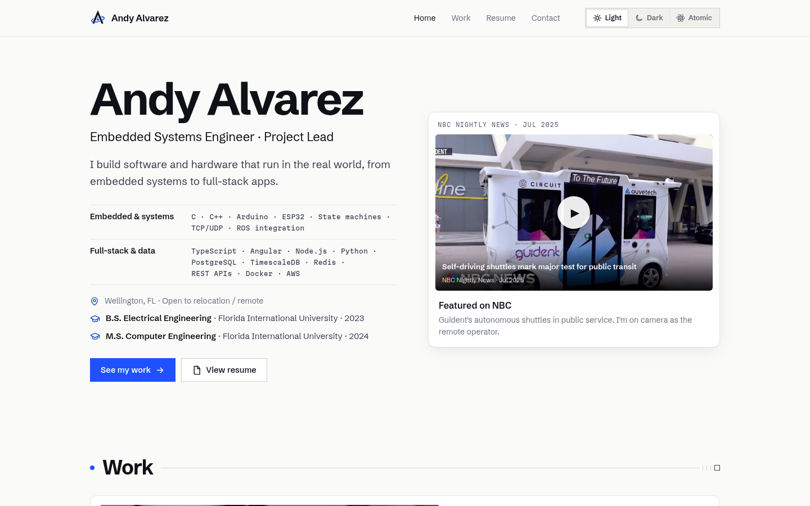
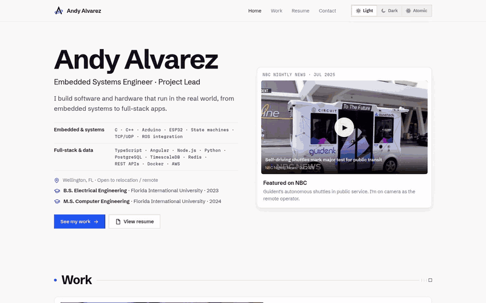

# andy-portfolio

Source for my personal engineering portfolio, live at [andyalvarez.dev](https://andyalvarez.dev).





## Tech stack

- **Angular 22** with standalone components and SCSS; the production build prerenders `/` to static HTML
- **Cloudflare Workers** (static assets) for hosting, deployed from GitHub

## Getting started

```bash
npm install
npm start          # dev server at http://localhost:4200
npm run build      # production build + prerender of / in dist/andy-portfolio/browser
```

## Deployment

Every push to `main` builds and deploys through Cloudflare Workers Builds:

- Build command: `npx ng build`
- Deploy command: `npx wrangler deploy`

`wrangler.jsonc` serves `dist/andy-portfolio/browser` and falls back to `index.html` for client-side routes.

## Project structure

| Path | Contents |
|---|---|
| `src/app/data/` | Page content: profile, projects, experience, resume, videos, media |
| `src/app/components/` | Page sections: hero, featured projects, resume, contact |
| `src/app/shared/` | Reusable pieces: video players, PDF viewer, equalizer, icons |
| `src/styles.scss` | Theme colors, typography, shared styles |
| `public/assets/` | Images, video clips, documents, fonts |

Most content changes only touch the files in `src/app/data/`.

## Contact

- Email: [andydalvarez30@gmail.com](mailto:andydalvarez30@gmail.com)
- LinkedIn: [linkedin.com/in/andydalvarez](https://www.linkedin.com/in/andydalvarez)
